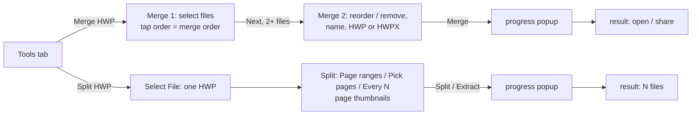

# Merge / Split HWP – POC

Branch `poc/hwp-merge-split` (on top of `feat/storekit2`). UI design: Claude Design canvas
"HWP Merge & Split – POC flows" — https://claude.ai/artifact/JW3jFaSXE39L8DG3onkJH5

## Flows

Outputs are written to Documents next to the originals (`<name>.hwp`, `<source>_part<n>`,
`<source>_pages`); originals are never changed.

## App code

| File | Role |
|---|---|
| `Services/HwpMergeSplitService.swift` | merge (`RhwpDocument.append`), split (`extractPages(from:to:)` on a fresh copy per part), pick (`extractPages(_:)`), save + `FileStore.notifyChanged` |
| `Services/HwpPageThumbnailRenderer.swift` | page thumbnails (`renderPDF(page:)` → PDFKit), serial queue + cache |
| `Screens/MergeSplit/*` | Merge 1/2, Split, progress popup, result, shared UI bits, `SplitPlan` (pure logic) |
| `Screens/Tools/ToolKind.swift`, `ToolsViewController.swift` | two new cards (3rd row) |

## Engine (HwpEditorKit, local)

The app points at the local clone `../../HwpEditorKit` (branch `poc/merge-split`) instead of the
remote `exactVersion 1.11.3` — switch back before any release build.

- Engine `rhwp_editor_mobile-ios` branch `poc/merge-split`: `34cc109` (core `append_document` +
  `extract_pages`, FFI `rhwp_doc_append_document` / `rhwp_doc_extract_page_range` /
  `rhwp_doc_extract_pages`, tests, local core patch regenerated), `8155d0e` (xcframework).
- Kit `HwpEditorKit` branch `poc/merge-split`: `90390ff`.
- Swift: `append(_:) -> RhwpAppendReport`, `extractPages(from:to:)`, `extractPages(_:)` →
  `RhwpPageExtractReport` (1-based pages).

Merge appends the other document's sections and DocInfo tables with ID offsets (shapes, styles,
fonts, border fills, numbering, images, fields, OLE/chart ids, headers/footers, master pages…);
same-name styles are reused (style id is one byte). Mixed HWP/HWPX inputs are converted to the
target format first. Tests (cargo + kit on simulator) pass; page drift 0 on the samples.

## Known limits (POC)

- Split keeps whole paragraphs: a paragraph crossing a cut goes to both parts (picking page 4 can
  give 2 pages).
- Merge: list numbering restarts per source; page/footnote numbers continue; page-number position and
  master pages of the first document carry onto appended parts that have none; field/bookmark names
  can repeat; memo shapes, track changes and extra DocInfo records of appended docs are not carried.
- Not yet opened in Hancom (HWP and HWPX output, master pages, headers/footers).
- Strings English only; card art uses SF Symbols placeholders; no premium gate; no remote ad place.

## Open questions

- Appended parts: block or continue the first document's page numbers / master pages?
- Split: keep paragraph cutting, or invest in exact page-level cutting?
- Premium gate for merge / split, and where?
