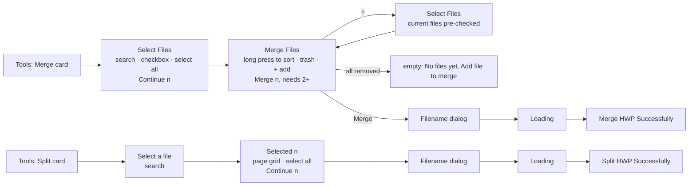

# Merge / Split HWP

Branch `poc/hwp-merge-split`. UI from Figma "🈯 HWP Edit": section **Merge HWP** (`6978:109459`) and
**Split HWP** (`6978:110902`). (The earlier Claude Design canvas "HWP Merge & Split – POC flows" is
superseded by these designs.)

## Flows

- Merge output is always `.hwp` (HWPX inputs are converted by the engine); the merge order is the
  pick order, then whatever the user drags.
- Split = the picked pages go into **one** new file named in the dialog, in the source's format.
- Outputs land in Documents (My Files); originals are never changed. Result screen = the convert
  result screen (Name / Size / Path, Back Home / Open) with its own title.

## App code

| File | Role |
|---|---|
| `Screens/MergeSplit/MergeSplitFlow.swift` | entry points used by the Tools cards |
| `Screens/MergeSplit/HwpFilePickerViewController.swift` | Select Files (multi, tap order) / Select a file (single), search |
| `Screens/MergeSplit/MergeFilesViewController.swift` | merge list: drag reorder, delete, add, empty state, name → merge |
| `Screens/MergeSplit/SplitPagesViewController.swift`, `SplitPageCell.swift` | page grid with thumbnails, select all, name → extract |
| `Screens/MergeSplit/LoadingOverlayViewController.swift` | dim + the shared loading Lottie (`converting_loading.json`) while the engine works |
| `Screens/MergeSplit/HwpFileRowCell.swift`, `MergeSplitUIKit.swift` | file row (checkbox / trash), search pill, primary button, bottom bar, select-all |
| `Screens/Tools/ConvertResultViewController.swift` | shared success screen (`title`, `place`); drops `ToolFlowScreen`s from the stack on Open |
| `Services/HwpMergeSplitService.swift` | `merge(_:outputName:)`, `extract(_:pages:outputName:)` |
| `Services/HwpPageThumbnailRenderer.swift` | page thumbnails (`renderPDF(page:)` → PDFKit), serial queue + cache |

Assets (from Figma, `Assets.xcassets/App`): `img_card_merge_bg`, `img_card_split_bg`,
`ic_checkbox_off/on`, `ic_select_all_off/on`, `ic_trash_red`, `ic_sort_hint`, `ic_fab_add`,
`ic_page_check_off/on`, `img_empty_merge_files`.

## Engine (HwpEditorKit, local)

The app points at the local clone `../../HwpEditorKit` (branch `poc/merge-split`) instead of the
remote `exactVersion 1.11.3` — switch back before any release build.

- Engine `rhwp_editor_mobile-ios` branch `poc/merge-split`: `34cc109` (core `append_document` +
  `extract_pages`, FFI, tests), `8155d0e` (xcframework).
- Kit `HwpEditorKit` branch `poc/merge-split`: `90390ff` — `append(_:)`, `extractPages(_:)`.

## Known limits

- Extract keeps whole paragraphs: a paragraph running across a page edge comes along whole, so the
  output can be a page longer than the pages picked.
- Merge: list numbering restarts per source; page numbers continue; page-number position and master
  pages of the first document carry onto appended parts that have none; field/bookmark names can repeat.
- Not yet opened in Hancom.
- Strings translated into all 32 app languages. Figma card subtitles are placeholders ("Convert DOC to HWP" / "Print
  document"); the app uses "Combine files into one" / "Extract pages to a new file".
- Figma hint text says "Long press to short manually" — shipped as "sort".
- Loading uses the project's shared Lottie spinner instead of the Figma GIF ("loading (4)").
