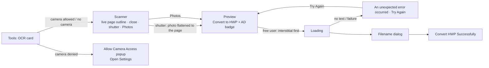

# OCR to HWP

Branch `poc/ocr-to-hwp` (on top of `poc/hwp-merge-split`). UI from Figma "🈯 HWP Edit", section
**OCR** (`6988:130354`).

## Flow

## How the page keeps its frame

1. **Page**: camera captures and photos are cut to the sheet (Vision rectangles + Core Image
   perspective correction). The aspect is taken from the edge lengths and snapped to A4 when close.
   Photos are only cut when the sheet covers ≥ 50% of the picture.
2. **Text**: Vision `VNRecognizeTextRequest`, accurate, `ko-KR` + `en-US`, on device. Short unsure
   reads (≤ 4 chars, confidence < 0.5: logos, stamps) stay in the background image.
3. **Layout** (`OcrPageLayout`): paper = A4 portrait/landscape (or the image's own proportion); every
   line at the same spot in points; font size from the box height, refined by the text width in the
   engine's "맑은 고딕" metrics (Hangul 0.95 em, A–Z 0.584, a–z 0.476, digits 0.525, space 0.444),
   snapped to the sizes used on the page and never wider than the line's box; coloured ink kept.
4. **Background** (`OcrBackgroundCleaner`): the page through `CIDocumentEnhancer`, each recognised
   line painted over with the colour around it → table lines, boxes, logos, pictures stay behind the
   editable text.
5. **Engine**: `RhwpDocument.importOCR(json:)` (kit `poc/merge-split`, engine `adf849e`) groups lines
   into blocks and writes each block as a borderless floating text box ("glass box") at its position,
   background image behind text — the same writer as PDF → HWP.

## App code

| File | Role |
|---|---|
| `Screens/Ocr/OcrFlow.swift` | entry from Tools: camera permission → scanner or popup |
| `Screens/Ocr/OcrCameraViewController.swift`, `OcrCameraSession.swift` | scanner UI, AVFoundation session, live page outline, capture, Photos picker |
| `Screens/Ocr/OcrPreviewViewController.swift` | preview, AD badge + interstitial (`ocr_screen`), loading, error, file name, result |
| `Screens/Ocr/CameraPermissionPopupViewController.swift` | "Allow Camera Access" |
| `Screens/Common/DocumentErrorViewController.swift` | `Content.ocr` (torn page, Try Again, header hairline) |
| `Services/Ocr/*` | recogniser, layout, background cleaner, page detector, `OcrToHwpService` |

## Measured (simulator, iPhone 17)

| Input | Result |
|---|---|
| Clean Korean page (IITP notice, 1654 px) | CER 4.5% incl. reading-order effects; layout, boxes, shading kept |
| Same page as a blurred, tilted fake photo | page found and flattened; CER 34% (blur), no overflow |
| Exam page (2 columns, formulas) | Korean 88/88 Hangul chars; columns and rules kept; formulas garbled |
| Photo without text | error screen |

## Known limits

- One page per conversion (the design has one preview page).
- Formulas, handwriting and very small text are not recognised as text (they stay in the image only
  when the recogniser skipped them).
- A logo read together with neighbouring text becomes text (e.g. "IITP" → "1TP").
- Interstitial uses ad place `ocr_screen`: it needs a remote config entry, otherwise nothing shows.
- Figma's Loading frame labels the button "Scan with OCR"; the app keeps "Convert to HWP" (main frame).
- Permission steps follow the design ("Permissions") although iOS shows the Camera switch directly.
