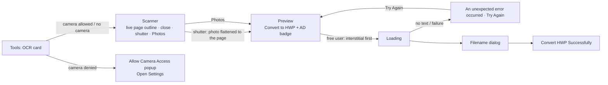

# OCR to HWP

Branch `poc/ocr-to-hwp` (on top of `poc/hwp-merge-split`). UI from Figma "🈯 HWP Edit", section
**OCR** (`6988:130354`).

## Flow

## How the page keeps its frame

1. **Page**: camera captures and photos are cut to the sheet (Vision rectangles + Core Image
   perspective correction). The aspect is taken from the edge lengths and snapped to A4 when close.
   Photos are only cut when the sheet covers ≥ 50% of the picture.
2. **Text**: Vision `VNRecognizeTextRequest`, accurate, `ko-KR` + `en-US`, on device. Short unsure
   reads (≤ 4 chars, confidence < 0.5: logos, stamps) stay in the background image.
   **Orientation**: each line's reading direction comes from its Vision quad; when most text reads
   sideways or upside down the page is turned (90 / −90 / 180°) and read again. Lines in another
   direction than the page (a rotated table label) stay in the background picture.
3. **Layout** (`OcrPageLayout`): paper = A4 portrait/landscape (or the image's own proportion); every
   line at the same spot in points; font size from the box height, refined by the text width in the
   engine's "맑은 고딕" metrics (Hangul 0.95 em, A–Z 0.584, a–z 0.476, digits 0.525, space 0.444),
   snapped to the sizes used on the page and never wider than the line's box.
4. **Colour** (`OcrInkSampler`): paper = median of a ring just outside the line, ink = the 15% of
   pixels farthest from it. Coloured ink keeps its colour, ink lighter than its paper (white on a dark
   band, dark-mode screenshots) keeps its colour, black / gray / blurred dark ink → default black.
   Near-equal inks on a page are merged into one colour.
5. **Background** (`OcrBackgroundCleaner`): the page through `CIDocumentEnhancer`, each recognised
   line painted over with the colour around it → table lines, boxes, logos, pictures stay behind the
   editable text.
6. **Engine**: `RhwpDocument.importOCR(json:)` (kit `poc/merge-split`) groups lines into blocks and
   writes each block as a borderless floating text box ("glass box") at its position, background image
   behind text — the same writer as PDF → HWP. Left-aligned boxes open to the free space on their
   right (next block or the right margin) so typed text runs on along the line instead of wrapping
   after two characters; nothing on the page moves (checked glyph by glyph on 26 pages).
   Landscape pages are written the HWP way (portrait paper size + landscape flag).

## App code

| File | Role |
|---|---|
| `Screens/Ocr/OcrFlow.swift` | entry from Tools: camera permission → scanner or popup |
| `Screens/Ocr/OcrCameraViewController.swift`, `OcrCameraSession.swift` | scanner UI, AVFoundation session, live page outline, capture, Photos picker |
| `Screens/Ocr/OcrPreviewViewController.swift` | preview, AD badge + interstitial (`ocr_screen`), loading, error, file name, result |
| `Screens/Ocr/CameraPermissionPopupViewController.swift` | "Allow Camera Access" |
| `Screens/Common/DocumentErrorViewController.swift` | `Content.ocr` (torn page, Try Again, header hairline) |
| `Services/Ocr/*` | recogniser, layout, background cleaner, page detector, `OcrToHwpService` |

## Measured (simulator, iPhone 17)

Batch harness: the app's `Services/Ocr` sources compiled into a simulator command-line tool
(`simctl spawn`), engine step on macOS against the same Rust code; scored against ground truth.

| Input | CER | Notes |
|---|---|---|
| Clean Korean page (IITP notice, 1654 px), also as HEIC / CMYK JPEG / 16-bit gray PNG / transparent PNG | 4.5–4.7% | layout, boxes, shading kept (CER includes reading order) |
| Same page rotated 90° / −90° / 180°, and as EXIF-rotated JPEG | 4.5–4.6% | page turned upright |
| Same page in a 48 MP photo / on a desk (40% of the photo) | 5.6–6.1% | peak memory ~240 MB (simulator) |
| Same page as a blurred, tilted fake photo | 34% | blur; no overflow |
| Synthetic: English letter, coloured lines, landscape slide (also sideways), banner, tiny 160×60, long line, 40-line 8 pt page | 0–0.7% | colours kept, landscape page stays landscape |
| Dark-mode phone screenshot (white on black) | 0.5% | white text on the dark background |
| Table 4×4 | all characters right | cell-by-cell order (41.7% CER is order only) |
| Symbols (※ ① 「」 ₩ ○ ● ■ ▶ ★) | 10.7% | ○ ● ■ ▶ → "000*" |
| Exam page (2 columns, formulas) | Korean 88/88 | formulas garbled |
| Photo without text | — | error screen, Try Again returns to the preview |

Engine robustness: 26 malformed / extreme JSON inputs (empty, wrong types, invalid UTF-8, 6000-char
line, 3000 lines, 50 pages, zero / negative / huge sizes and positions, emoji + control characters,
missing / non-image background) → no crash, clear errors. Output parsed by an independent reader
(pyhwp 0.1b15): no errors, text in the text boxes, landscape `PageDef` = 59528 × 84189 + landscape.

## Known limits

- One page per conversion (the design has one preview page).
- Bold / italic are not detected (bold headings come out regular weight).
- Formulas, handwriting and very small text are not recognised as text (they stay in the image only
  when the recogniser skipped them).
- A logo read together with neighbouring text becomes text (e.g. "IITP" → "1TP").
- Interstitial uses ad place `ocr_screen`: it needs a remote config entry, otherwise nothing shows.
- Figma's Loading frame labels the button "Scan with OCR"; the app keeps "Convert to HWP" (main frame).
- Permission steps follow the design ("Permissions") although iOS shows the Camera switch directly.
