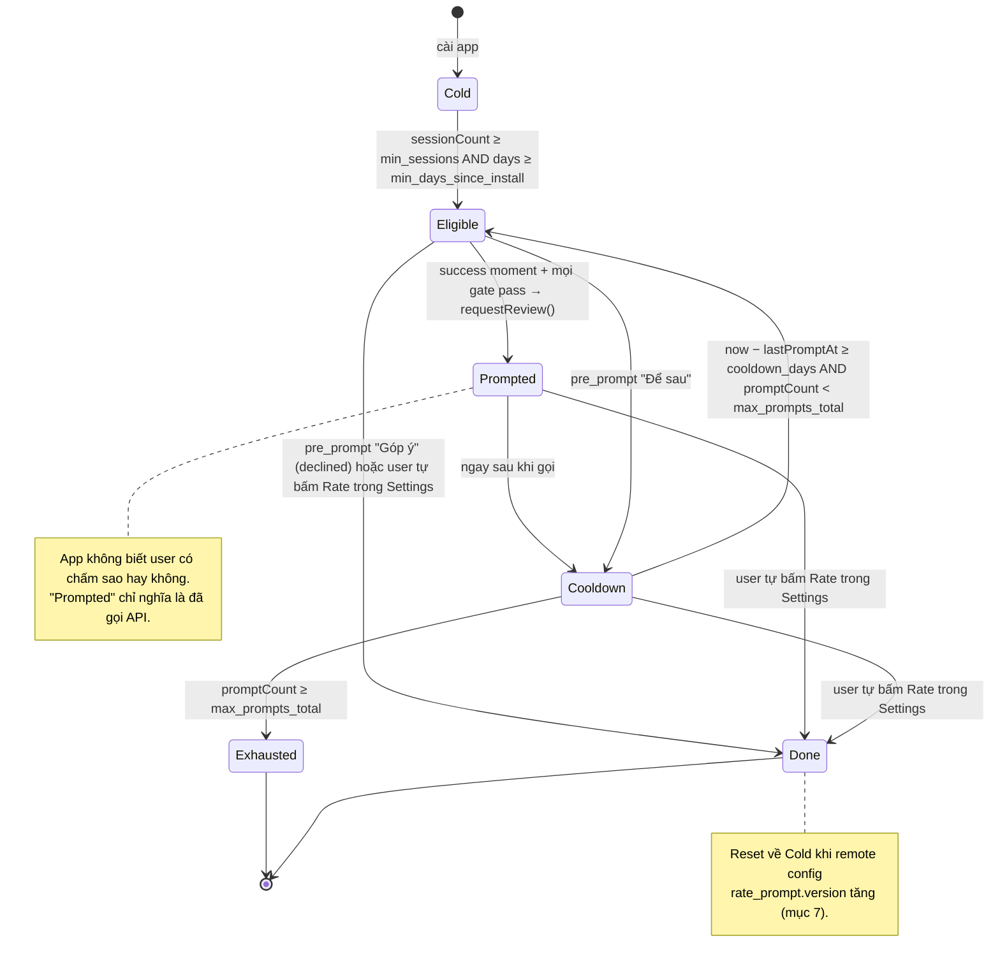
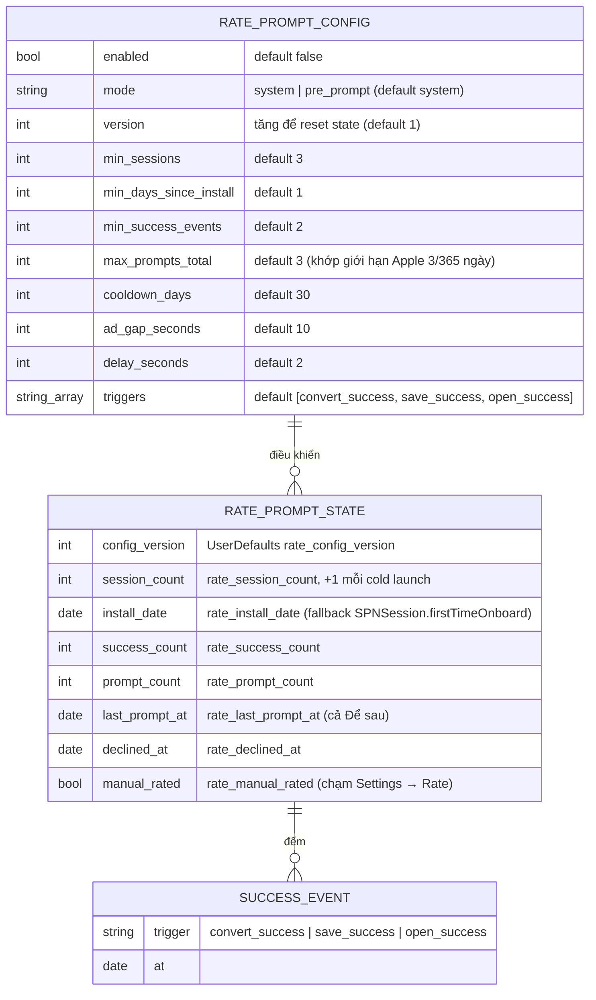

# Rate app prompt (xin đánh giá trên App Store)

> **Status**: Draft
> **Owner**: datnh
> **Last updated**: 2026-10-21
> **Related code** (hiện trạng, chưa có flow tự động):
> `HWPViewer/HWPViewer/Screens/Settings/SettingsViewController.swift` (row "Rate app" thủ công),
> `HWPViewer/HWPViewer/AppEnvironment/AppRemoteConfigs.swift` (`app_extra_configs`),
> `HWPViewer/HWPViewer/Managers/TrackingManager.swift`,
> `HWPViewer/HWPViewer/Screens/FileActions/AppAlertViewController.swift` (popup chuẩn của app)

## 1. Summary

App tự động xin user đánh giá trên App Store tại **khoảnh khắc user vừa đạt được việc gì đó**
(convert xong, lưu file xong, mở file lần thứ N), thay vì chỉ có row "Rate app" trong Settings.
Prompt dùng API hệ thống (`SKStoreReviewController` / `AppStore.requestReview`), có bộ điều kiện
(gating) riêng của app để không hỏi user mới, không hỏi dồn dập, không đè lên quảng cáo/paywall,
và mọi ngưỡng đều chỉnh được từ Firebase Remote Config. Mục tiêu: tăng số rating/review tự nhiên
từ user hài lòng, không làm tăng rating 1 sao do hỏi sai lúc.

Hiện trạng (đã đọc code): không có prompt tự động, không có bộ đếm session/launch persist,
row Settings → Rate gọi thẳng `SKStoreReviewController.requestReview(in:)` không tracking.

## 2. Actors

| Actor | Role |
|---|---|
| End user | Dùng app, đạt "success moment", trả lời prompt (hoặc bỏ qua) |
| RatePromptManager (app) | Thành phần mới: đếm, kiểm tra điều kiện, gọi prompt, lưu trạng thái, bắn tracking |
| iOS / StoreKit | Hiển thị sheet rating hệ thống; **tự quyết** có hiện hay không (tối đa 3 lần / 365 ngày / app) |
| App Store | Đích của fallback "Viết đánh giá" (`?action=write-review`) |
| Firebase Remote Config | Cung cấp ngưỡng/bật tắt (`app_extra_configs.rate_prompt`) |
| Firebase Analytics | Nhận event tracking |
| SPNAds (interstitial / app-open), PaywallPresenter | Nguồn "xung đột": prompt không được đè lên hoặc chen ngay sau các màn này |

## 3. Pre-conditions

- Remote config đã fetch xong (splash) và `rate_prompt.enabled == true`.
- App đang `active`, không có popup/sheet nào đang present trên top VC.
- Không phải phiên đầu tiên sau cài đặt; đã qua tối thiểu `min_days_since_install` ngày.
- Chưa vượt `max_prompts_total` lần đã gọi prompt; đã qua `cooldown_days` kể từ lần gọi trước.
- Không nằm trong `ad_gap_seconds` giây sau khi interstitial / app-open ad vừa đóng; paywall không đang hiện.
- User chưa chạm "Rate app" thủ công trong Settings (nếu đã chạm → coi là done, không tự hỏi nữa).

## 4. User flow

```mermaid
flowchart TD
    Start([Success moment xảy ra]) --> Which{Trigger nào?}
    Which -- convert_success --> Count[Ghi nhận trigger\nsuccessCount += 1]
    Which -- save_success --> Count
    Which -- open_success --> Count
    Count --> Enabled{rate_prompt.enabled?}
    Enabled -- No --> End([Không làm gì])
    Enabled -- Yes --> Gate{Đủ điều kiện?\nsession ≥ min_sessions\nngày ≥ min_days_since_install\nsuccessCount ≥ min_success_events\nprompts < max_prompts_total\nqua cooldown\nkhông vừa có ad / paywall\nkhông có popup đang hiện}
    Gate -- No --> End
    Gate -- Yes --> Delay[Chờ delay_seconds\ncho màn hình ổn định]
    Delay --> StillOK{Vẫn active,\nkhông popup?}
    StillOK -- No --> End
    StillOK -- Yes --> Mode{mode}
    Mode -- system --> Sys[Gọi requestReview\nghi lastPromptAt, promptCount += 1]
    Mode -- pre_prompt --> Pre[Popup app:\n"Bạn thấy HWP Viewer thế nào?"]
    Pre -- Thích --> Sys
    Pre -- Góp ý --> Feedback[Mở mail góp ý\nghi declinedAt]
    Pre -- Để sau --> Later[Ghi lastPromptAt\nkhông tăng promptCount]
    Sys --> iOS{iOS quyết định\nhiện sheet?}
    iOS -- Có --> Sheet[User chấm sao / bỏ qua\napp KHÔNG biết kết quả]
    iOS -- Không --> End
    Sheet --> End
    Feedback --> End
    Later --> End
```

Ghi chú:
- Flow **không** bao giờ chặn thao tác chính (convert result vẫn hiện, file vẫn lưu). Prompt là việc phụ, chạy sau.
- Ở `mode = system` (khuyến nghị, đúng HIG), app không có bước hỏi trước. Ở `mode = pre_prompt`,
  popup dùng `AppAlertViewController` sẵn có; xem rủi ro ở mục 11.

## 5. Sequence diagram

```mermaid
sequenceDiagram
    actor User
    participant Screen as ConvertResultVC / HwpViewerVC
    participant RPM as RatePromptManager
    participant RC as FirebaseRemoteConfigStore
    participant Ads as SPNAdsManager / PaywallPresenter
    participant UD as UserDefaults
    participant SK as StoreKit (iOS)
    participant GA as TrackingManager

    User->>Screen: Convert xong / Save xong / Mở file xong
    Screen->>RPM: recordSuccess(.convertSuccess)
    RPM->>UD: successCount += 1
    RPM->>RC: value("app_extra_configs").rate_prompt
    RC-->>RPM: {enabled, mode, ngưỡng...}
    RPM->>UD: đọc sessionCount, installDate, promptCount, lastPromptAt, manualRated
    RPM->>Ads: lastFullScreenAdDismissedAt? isPaywallPresented?
    Ads-->>RPM: timestamps / flags
    alt không đủ điều kiện
        RPM->>GA: rate_prompt_skipped {trigger, reason}
    else đủ điều kiện
        RPM->>RPM: đợi delay_seconds (main queue)
        RPM->>Screen: topViewController còn là màn này, không presented VC?
        alt mode == pre_prompt
            RPM->>User: AppAlert "Bạn thấy app thế nào?" [Thích / Góp ý / Để sau]
            RPM->>GA: rate_pre_prompt_shown {trigger}
            User-->>RPM: Thích
            RPM->>GA: rate_pre_prompt_answer {answer: like}
        end
        RPM->>UD: promptCount += 1, lastPromptAt = now
        RPM->>GA: rate_prompt_requested {trigger, mode, prompt_index}
        RPM->>SK: requestReview(in: windowScene)
        Note over SK,User: iOS tự quyết có hiện sheet; app không nhận callback, không biết user chấm mấy sao
        SK-->>User: Sheet rating (có thể không hiện)
    end
```

Nhánh "Góp ý": `RPM` mở `mailto:` (hoặc form feedback sẵn có nếu đã có), ghi `declinedAt`, bắn
`rate_pre_prompt_answer {answer: feedback}`, và **không** gọi StoreKit. Nhánh "Để sau": chỉ ghi
`lastPromptAt` để áp cooldown, không tính vào `promptCount`.

## 6. State machine — `RatePromptState` (persist trong UserDefaults)



## 7. Domain model

Không có backend; mọi thứ nằm ở client. Remote config là input, UserDefaults là state.



`RATE_PROMPT_CONFIG` là object `rate_prompt` lồng trong key `app_extra_configs` của Remote Config
(decode ở `AppRemoteConfigs.swift`, default trong `Resources/DefaultConfigs/DefaultConfigs.json`).

## 8. Success moments (điểm gọi `recordSuccess`)

| Trigger | Vị trí trong code hiện tại | Ghi chú |
|---|---|---|
| `convert_success` | `ConvertResultViewController.viewDidAppear` (sau khi `SelectFileViewController.startConvert` nhận `.success`) | Tín hiệu mạnh nhất: user vừa được giá trị rõ ràng. Ưu tiên 1. |
| `save_success` | `HwpViewerViewController.performSave()` nhánh `.success` | Sau `vm.markSaved()`; gọi khi đã thoát edit mode, màn hình ổn định. |
| `open_success` | `HwpViewerViewController.loadDocument()` sau `coordinator.onFirstRender` | Chỉ đếm, **không** prompt ngay vì `FileActionsCoordinator.open` vừa có thể hiện interstitial (`place: .home`) và paywall `view_file`. Gate `ad_gap_seconds` xử lý. |

Không dùng: print (không có completion), share (không có `completionWithItemsHandler`), rename/bookmark (quá nhỏ).

## 9. Edge cases & failure modes

| # | Scenario | Expected behavior |
|---|---|---|
| 1 | iOS không hiện sheet dù app đã gọi (hết quota 3/365, Screen Time, user tắt "In-App Ratings & Reviews") | App vẫn tính là đã prompt (`promptCount += 1`, cooldown). Không fallback mở App Store, không hỏi lại ngay. |
| 2 | User đang premium | Vẫn hỏi (premium thường hài lòng hơn). Không gate theo premium. |
| 3 | Interstitial vừa đóng < `ad_gap_seconds` | Skip, bắn `rate_prompt_skipped {reason: ad_gap}`. Không "xếp hàng" để hỏi lại sau. |
| 4 | Paywall đang hiện / sắp hiện (`PaywallPresenter.presentIfAllowed` cùng khoảnh khắc) | Paywall thắng. Rate prompt skip. Thứ tự ưu tiên: paywall > interstitial > rate. |
| 5 | Có popup khác đang present (SaveChangesPopup, ErrorPopup, HUD) | Kiểm tra `topViewController.presentedViewController == nil` sau delay; nếu có → skip. |
| 6 | App vào background trong `delay_seconds` | Huỷ, không prompt khi quay lại foreground (tránh trùng app-open ad). |
| 7 | Remote config fetch fail / chưa fetch | Dùng default trong code (`enabled = false`) → không hỏi. |
| 8 | Remote tăng `version` | Reset toàn bộ state về Cold (cho phép chiến dịch hỏi lại sau bản release lớn). |
| 9 | User bấm "Rate app" thủ công trong Settings | `manual_rated = true` → state Done, không tự hỏi nữa. Row Settings không bị gate, luôn hoạt động; fallback mở `appStoreUrl + "?action=write-review"`. |
| 10 | `mode = pre_prompt`, user chọn "Góp ý" | Mở mail góp ý; `declined_at` set; state Done cho đến khi `version` tăng. Không bao giờ gọi StoreKit trong phiên đó. |
| 11 | Cùng một success moment bắn 2 lần (convert 2 file liên tiếp) | `successCount` tăng mỗi lần; prompt chỉ 1 lần nhờ cooldown. |
| 12 | Cold launch nhiều lần trong 1 ngày để "farm" session | `min_days_since_install` chặn; `session_count` chỉ +1 mỗi cold launch (không tính foreground). |
| 13 | iOS < 14 | Không có `requestReview(in:)` → dùng `SKStoreReviewController.requestReview()` cũ; iOS 16+ có thể dùng `AppStore.requestReview(in:)` (StoreKit 2). Chọn 1 wrapper, kiểm tra deployment target. |
| 14 | Reinstall app | UserDefaults mất → state Cold lại; chấp nhận (Apple vẫn giữ quota 365 ngày phía hệ thống). |

## 10. Tracking (Firebase Analytics, snake_case theo pattern hiện có)

| Event | Params | Khi nào |
|---|---|---|
| `rate_prompt_skipped` | `trigger`, `reason` (`disabled`, `cold`, `cooldown`, `exhausted`, `ad_gap`, `paywall`, `popup`, `background`, `manual_rated`, `declined`) | Mỗi lần success moment bị chặn |
| `rate_prompt_requested` | `trigger`, `mode`, `prompt_index` (1..max), `session_count`, `days_since_install` | Ngay trước `requestReview` |
| `rate_pre_prompt_shown` | `trigger` | Chỉ `mode = pre_prompt` |
| `rate_pre_prompt_answer` | `answer` (`like`, `feedback`, `later`) | Chỉ `mode = pre_prompt` |
| `rate_manual_tapped` | `source` = `settings` | Row Settings → Rate |

Kết quả thực (user chấm mấy sao) **không đo được** trong app; đo qua App Store Connect
(Ratings theo ngày) đối chiếu với `rate_prompt_requested`.

## 11. Glossary

| Term | Definition |
|---|---|
| **Success moment** | Sự kiện user vừa hoàn tất một việc có giá trị (convert xong, lưu xong, mở file xong). Là trigger duy nhất của flow; app không hỏi theo timer. |
| **Rate prompt** | Lời mời đánh giá trên App Store, do `RatePromptManager` phát ra tại một success moment đã qua gate. Gồm bước pre-prompt (tuỳ chọn) và lời gọi StoreKit. |
| **System review sheet** | Sheet 5 sao của iOS hiện bởi `SKStoreReviewController.requestReview(in:)` / `AppStore.requestReview`. iOS giới hạn 3 lần / 365 ngày / app và có thể không hiện; app không nhận kết quả. |
| **Pre-prompt** | Popup của app hỏi "Bạn thấy app thế nào?" trước khi gọi system sheet. Bật bằng `mode = pre_prompt`. Rủi ro HIG (xem Open questions). |
| **Gate** | Một điều kiện trong chuỗi kiểm tra trước khi prompt (session, ngày, cooldown, ad gap, popup...). Fail bất kỳ gate nào → skip, không xếp hàng. |
| **Cooldown** | Khoảng `cooldown_days` sau `last_prompt_at` mà app không hỏi lại. Áp cho cả "Để sau". |
| **Session** | Một cold launch của app (process start). Foreground lại không tính. Hiện app chưa persist bộ đếm này; flow yêu cầu thêm `rate_session_count`. |
| **Manual rate** | User tự chạm row "Rate app" trong Settings. Luôn khả dụng, không gate, và chuyển state tự động sang Done. |
| **Config version** | Số `rate_prompt.version` trong Remote Config; tăng để reset toàn bộ state client (chiến dịch hỏi lại). |

## 12. Out of scope

- Android.
- UI chấm sao tự vẽ trong app (vi phạm guideline, không làm).
- Form feedback đầy đủ (v1 chỉ `mailto:` tới email hỗ trợ sẵn có).
- Gắn prompt vào print/share (chưa có completion để biết thành công).
- A/B test ngưỡng qua Firebase Experiments (có thể làm sau bằng chính các key trên).

## 13. Open questions

- [ ] **Mode mặc định**: `system` (đúng Apple HIG: "Don't use a custom prompt") hay `pre_prompt` (lọc user chưa hài lòng sang góp ý, nhưng Apple có thể reject nếu review viên để ý)? Đề xuất: ship `system`, giữ `pre_prompt` sau remote flag để thử.
- [ ] **Ngưỡng ban đầu**: `min_sessions = 3`, `min_days = 1`, `min_success_events = 2`, `cooldown = 30 ngày` có hợp với retention thực tế không? Cần số liệu D1/D7 từ Firebase.
- [ ] `open_success` có nên là trigger hay chỉ đếm? Mở file là hành động thường xuyên nhất nhưng cũng là lúc vừa có interstitial.
- [x] Deployment target = iOS 15.0 (pbxproj) → dùng `SKStoreReviewController.requestReview(in: windowScene)`; `AppStore.requestReview(in:)` (iOS 16+) chỉ là tuỳ chọn `#available`.
- [ ] Email góp ý: `AppConstants.swift` chưa có hằng số email hỗ trợ nào → cần bổ sung nếu bật `pre_prompt`.

## 14. Assumptions (cần xác nhận)

- Không có session counter persist hiện tại (đã kiểm tra: `SPNSession`, `IapTracking` chỉ có cờ first launch) → thêm mới `rate_session_count` tăng ở `AppDelegate.didFinishLaunching`.
- `SPNInterstitialService` / app-open ad có thể expose thời điểm đóng ad gần nhất (hoặc app tự ghi ở callback `.didDismiss` trong `FileActionsCoordinator.open`).
- `PaywallPresenter` có thể trả lời "đang hiện / sắp hiện" (hoặc kiểm tra `presentedViewController is PaywallViewController`).
- Remote config key mới đặt lồng trong `app_extra_configs` (key của riêng app), không thêm top-level key, để không đụng template của `scripts/make-remoteconfig-template.py`... nếu script yêu cầu top-level thì tách `rate_prompt_configs`.
- Row Settings → Rate giữ nguyên hành vi, chỉ thêm tracking + đặt `manual_rated` + fallback write-review.
